# WQF7009 Explainable Artificial Intelligence

Stroke classification on the Kaggle healthcare stroke dataset, with SHAP explanations for a Random Forest and a support vector machine.

Student: Ayaan Abdullahi Dhaqane  
Course: Advanced Machine Learning, Master of Artificial Intelligence  
Date: 13 November 2026

The target `stroke = 1` means a recorded stroke in this file. `stroke = 0` means no recorded stroke. The score is not a validated future stroke risk.

## Dataset

File: `healthcare-dataset-stroke-data.csv`  
Source: [Stroke Prediction Dataset on Kaggle](https://www.kaggle.com/datasets/fedesoriano/stroke-prediction-dataset)

| Item | Result |
|---|---|
| Rows and columns | 5,110 patients, 12 columns |
| Recorded strokes | 249 (4.87%) |
| No recorded stroke | 4,861 (95.13%) |
| Missing values | BMI only, 201 rows (3.93%) |
| Duplicate rows | 0 |
| Age | Mean 43.23 years, range 0.08 to 82 |
| Average glucose | Mean 106.15, range 55.12 to 271.74 |
| BMI, where recorded | Mean 28.89, range 10.3 to 97.6 |

Predictors are gender, age, hypertension, heart disease, ever married, work type, residence type, average glucose, BMI, and smoking status. The column `id` is not used as a predictor. In the file, the work-type category is spelled `Govt_job`. `Unknown` in `smoking_status` means the information is missing. It is not the same as never smoked.

Patients with a recorded stroke are older on average (67.7 years versus 42.0) and have higher average glucose (132.5 versus 104.8). The recorded stroke share is higher when hypertension or heart disease is present. These are associations in this file, not proof of cause.

## Files

| File | What it is |
|---|---|
| `Task1_Exploratory_Data_Analysis.ipynb` | Data checks, histograms, category counts, and stroke comparisons |
| `Task2_Create_SHAP_explainer.ipynb` | Random Forest, test metrics, and TreeExplainer check |
| `Task3_Force_plot.ipynb` | Local force plot for one test patient |
| `Task4_Summary_plot.ipynb` | Global summary plot and feature ranking |
| `Task5_SHAP_5_Slides_With_Cover.pptx` | Slides for a data scientist, a doctor, and a patient |
| `Task6_Basic_Kernel_SHAP_SVM.ipynb` | SVM explained with Kernel SHAP |
| `Assignment Stroke_SHAP_Report.docx` | Written report with the figures and numbers |
| `healthcare-dataset-stroke-data.csv` | Original dataset |
| `images/` | Plots saved from the notebook runs and shown below |

The notebooks follow the lecture scripts `00_data_exploration.py` and `03_shap.py`. They were run in Google Colab. Each modelling notebook uploads the original CSV and repeats the preprocessing. Do not replace the CSV with an already cleaned table. The cleaning code still expects the original column names.

## Preprocessing

Applied before the train-test split, as in the lecture `DataLoader`:

1. One-hot encode gender, ever married, work type, residence type, and smoking status.
2. Fill missing BMI with 0.
3. Drop `id`.

This leaves 21 predictors. Filling BMI with 0 matches the lecture code, but 0 is not a real body mass index.

The split is 80% training and 20% testing, `random_state = 2021`: 4,088 training rows and 1,022 test rows. The test set contains 50 stroke records. Random oversampling is used on the training set only (`random_state = 2021`), which balances it to 3,889 rows in each class. The SVM also standardises the features. That scaler is fit on the training data only.

## Task 1: Exploratory data analysis

`Task1_Exploratory_Data_Analysis.ipynb` prints the shape, `info`, histograms, missing values, stroke counts, category bar charts, and the stroke share by gender, hypertension, heart disease, and smoking status. It then shows the preprocessed table.

Age, average glucose, and BMI:

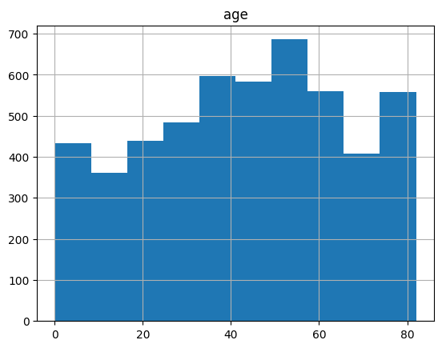

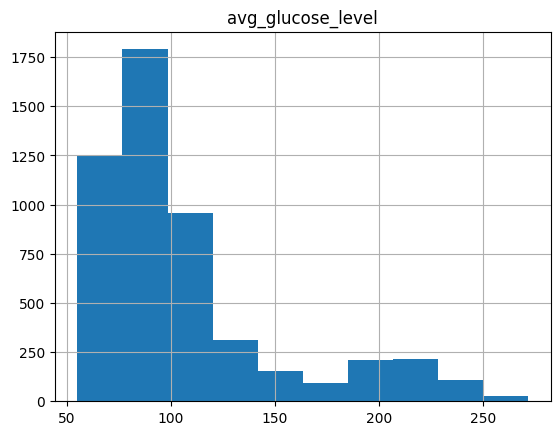

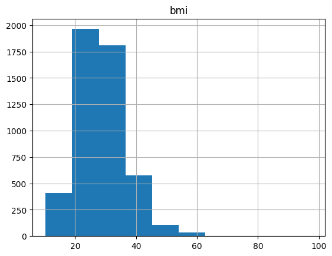

Hypertension, heart disease, and the stroke class. Stroke = 1 is the short bar:

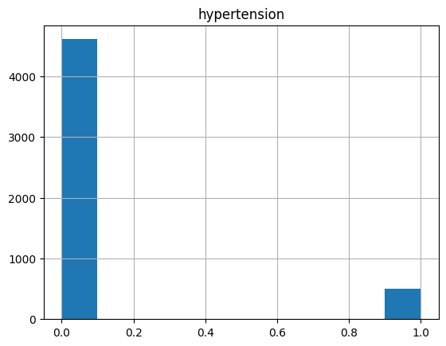

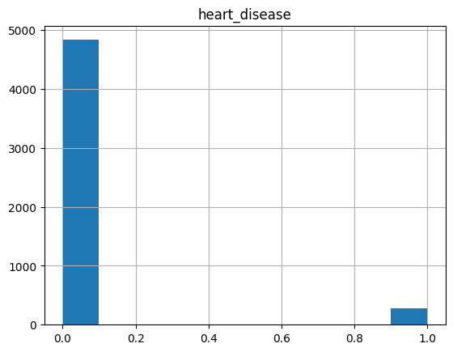

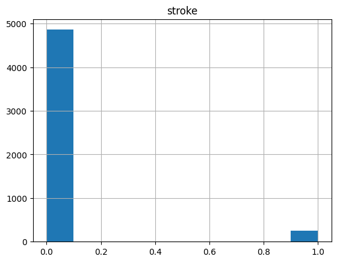

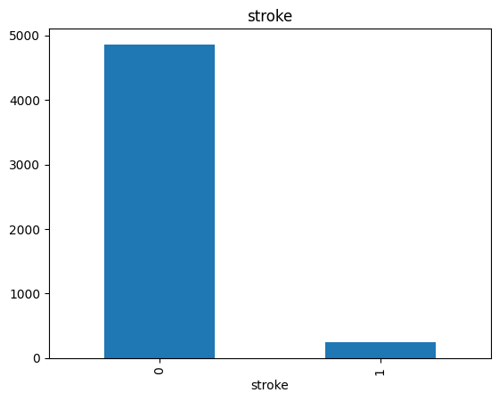

Category counts:

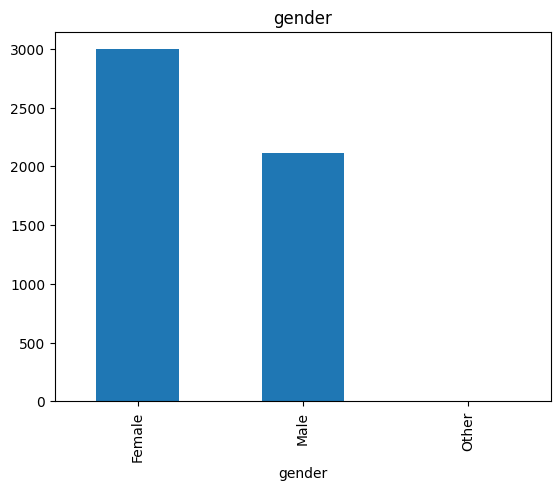

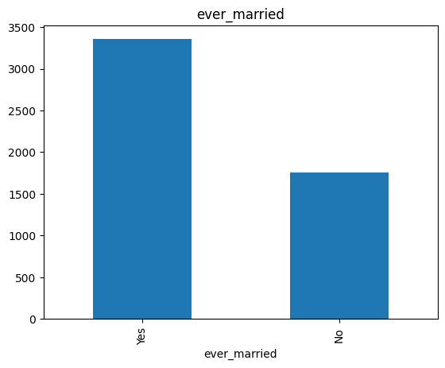

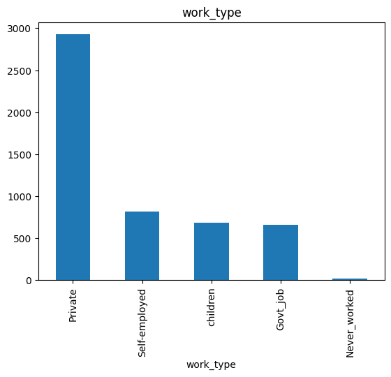

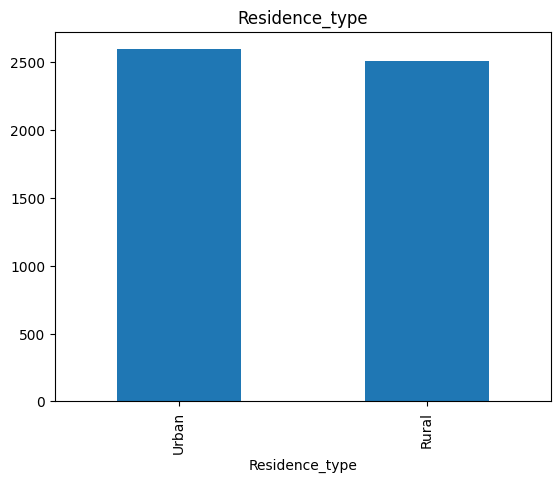

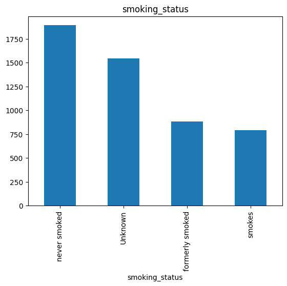

## Task 2: Random Forest and TreeExplainer

`Task2_Create_SHAP_explainer.ipynb` trains `RandomForestClassifier(random_state = 42)` and explains the probability of stroke = 1 with `shap.TreeExplainer`. `model.classes_` is `[0, 1]`. The decision threshold is 0.5.

Test results on 1,022 patients:

| Metric | Result |
|---|---|
| Accuracy | 0.943 |
| Balanced accuracy | 0.524 |
| Precision for stroke = 1 | 0.214 |
| Recall for stroke = 1 | 0.060 |
| F1 for stroke = 1 | 0.094 |
| ROC AUC | 0.761 |
| Average precision | 0.138 |
| Confusion matrix | TN 961, FP 11, FN 47, TP 3 |

Accuracy is high because most patients have no recorded stroke. The forest misses 47 of the 50 test stroke records. For the first test row, the base value is 0.4995 and the base value plus the SHAP values equals the model probability of 0.07.

## Task 3: Local force plot

`Task3_Force_plot.ipynb` explains test index 2085, the first row of the test set. It was not chosen because the plot looked favourable.

| Item | Value |
|---|---|
| Actual class | 0 |
| Predicted class | 0 |
| Probability of stroke = 1 | 0.07 |
| Base value | 0.4995 |
| Case type for the forest | True negative |
| Recorded values | Age 70, male, no hypertension, no heart disease, married, private work, rural, glucose 72.56, BMI 30.4, formerly smoked |

The probability falls from about 0.50 to 0.07. The largest downward contributions are glucose 72.56 (SHAP -0.220) and BMI 30.4 (SHAP -0.147). A positive SHAP value raises the stroke probability. A negative value lowers it. This is an explanation of the model, not a diagnosis.

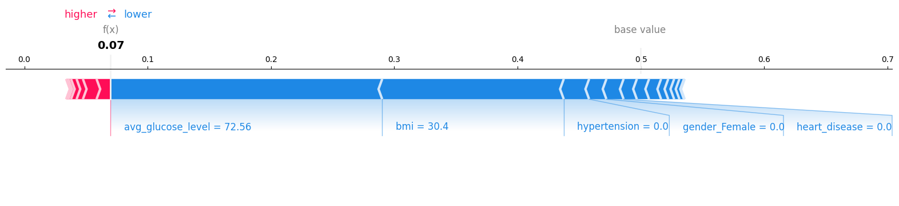

## Task 4: Global summary plot

`Task4_Summary_plot.ipynb` explains all 1,022 test patients. Mean absolute SHAP on the probability of stroke = 1:

| Rank | Feature | Mean absolute SHAP |
|---|---|---|
| 1 | age | 0.170 |
| 2 | avg_glucose_level | 0.094 |
| 3 | bmi | 0.087 |
| 4 | hypertension | 0.020 |
| 5 | smoking_status_formerly smoked | 0.014 |

On the summary plot, high age and high glucose generally raise the stroke probability. The test patient in Task 3 follows the glucose pattern. Age 70 would usually raise the probability, but for that one row the age contribution is near zero.

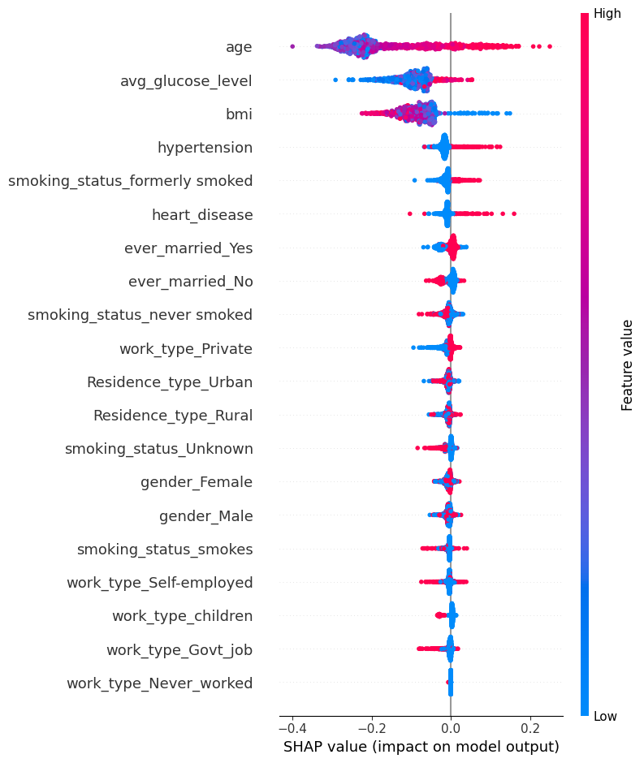

## Task 5: Three audience slides

`Task5_SHAP_5_Slides_With_Cover.pptx` explains the same Random Forest.

- Data scientist: the model, the 80/20 split, TreeExplainer, the test metrics, and the class imbalance. Accuracy is not used on its own.
- Doctor: the force-plot patient, what pushes the probability up or down, and the missed stroke records. The output is not a diagnosis.
- Patient: plain language. The score can be wrong, and it does not say whether the person will have a stroke in the future.

A cover slide and a short closing slide are also in the file.

## Task 6: SVM and Kernel SHAP

`Task6_Basic_Kernel_SHAP_SVM.ipynb` trains `SVC(kernel = 'rbf', probability = True, random_state = 42)` on the same split. Kernel SHAP explains `predict_proba` for class 1. The background is 20 scaled training rows (`random_state = 42`). The plots use 5 test rows and `nsamples = 100`, so the explanation is an approximation. The metrics use the full test set.

| Metric | SVM | Random Forest |
|---|---|---|
| Accuracy | 0.791 | 0.943 |
| Balanced accuracy | 0.615 | 0.524 |
| Precision for stroke = 1 | 0.102 | 0.214 |
| Recall for stroke = 1 | 0.420 | 0.060 |
| F1 for stroke = 1 | 0.164 | 0.094 |
| ROC AUC | 0.704 | 0.761 |
| Average precision | 0.138 | 0.138 |
| Confusion matrix | TN 787, FP 185, FN 29, TP 21 | TN 961, FP 11, FN 47, TP 3 |

The SVM finds more of the recorded strokes and also raises many false alarms. For the same test patient, the SVM probability is 0.74, while the forest probability is 0.07. The SVM force plot shows standardised values, not the original age or BMI. Age is the leading feature in both explanations. The SVM global plot is only five patients, so it is not a full ranking of the test set.

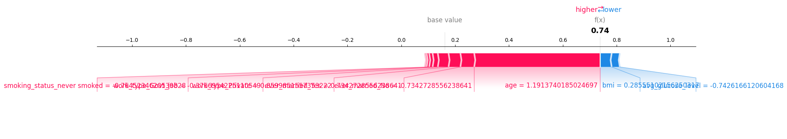

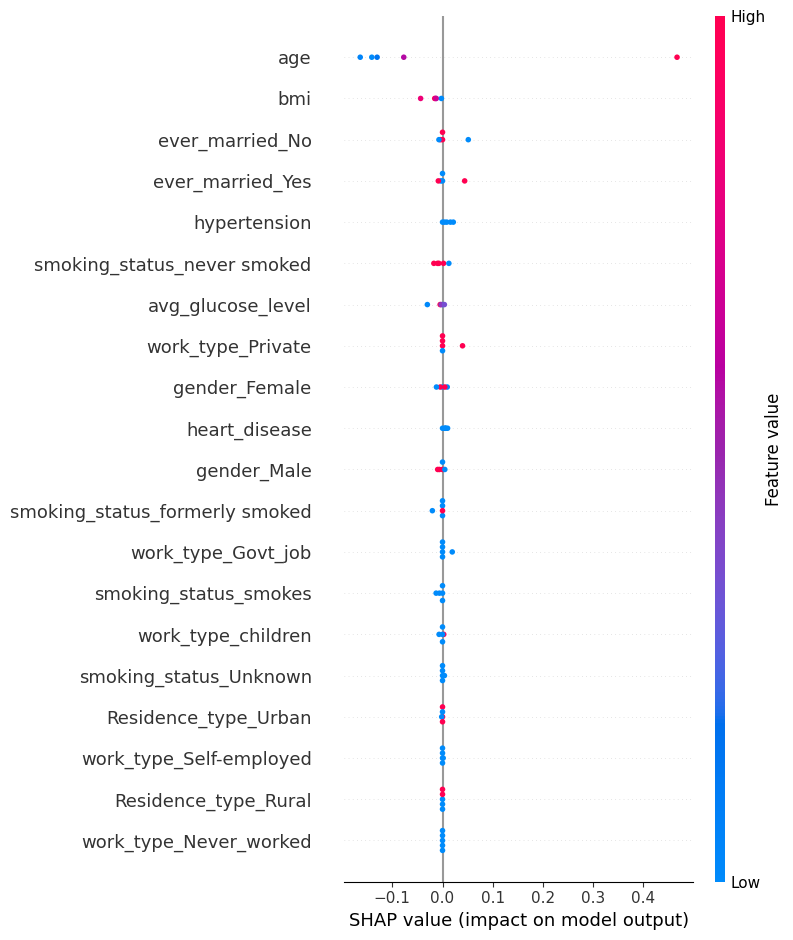

## How to run

Open a notebook in Google Colab, run the cells from the top, and upload `healthcare-dataset-stroke-data.csv` when the upload cell asks for it. The notebooks install `shap` and `imbalanced-learn` with pip. Task 6 is slower because Kernel SHAP evaluates the SVM many times.

## Limits

- The stroke class is rare, so accuracy alone is a weak score.
- Missing BMI is filled with 0 before the split.
- One-hot encoding is also fit on the full file before the split.
- The Kernel SHAP sample is small.
- SHAP describes these fitted models. It does not show that a feature causes stroke.
